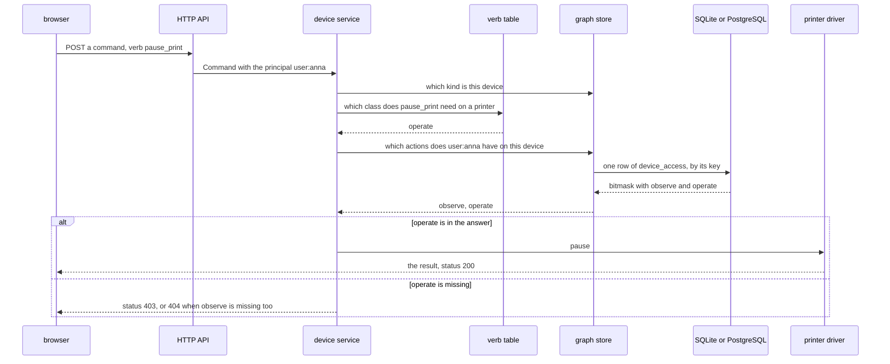
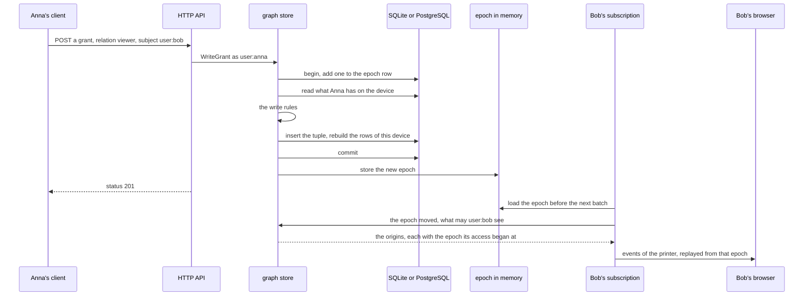

Permissions in this server are a map of connections. A person is a member of a
group, a group belongs to an organisation, and a printer belongs to an
organisation or to one person. When a person clicks pause, the server asks
whether any connection from that person to that printer allows "operate". The
code in `internal/authz` stores this map and answers that question. One
connection is a tuple. A tuple is one row that says a subject has a relation to
an object, such as `device:mk4#operator@user:anna`. The server does not follow
the connections when the click arrives. Every write to the map compiles it, in
the same transaction, into a table with one row for each person and printer.
That row has a bitmask of actions, and a check reads it by its key. The map is
stored in SQLite or in PostgreSQL, and every query has to work on both.

## Types, relations and actions are closed, and verbs are open

| term | what it is | the values |
|---|---|---|
| type of a caller | who a grant is given to | `user`, `group`, `service_account`, `device_credential`, `node`, `sink`, `history` |
| type of an object | what a grant is written on | `org`, `device_group`, `device`, `resource_kind` |
| role | a relation that gives actions | `viewer`, `operator`, `manager`, and `admin` on an org |
| structure | a relation that connects two things | `member`, `parent`, `org`, `group`, `agent` |
| other relations | a block removes every role of a person on one object, and ownership says whose machine it is | `blocked`, `owner` |
| device action | what a handler asks for on a device | `observe`, `operate`, `configure`, `administer`, `view_audit` |
| resource action | what a handler asks for on a resource kind | `view_resource`, `operate_resource`, `configure_resource`, `read_storage`, `write_storage` |
| driver action | asked on the kind `driver` | `admit_device` to let a device join, `develop_device` for the developer page |
| class | the action a verb needs | `operate` or `configure` |
| verb | one command a device accepts | `core.command.pause_print`, and any verb a driver declares |

A handler asks for an action and never for a role. `deviceMask` and
`resourceMask` in `internal/authz/vocabulary.go` say which actions each role
gives, and each role includes the one below it. A grant on a resource is
written on the kind, such as `resource_kind:storage`, and it covers every
instance of that kind. A new type, relation or action is an edit to
`vocabulary.go`. `Reconcile` writes the names into lookup tables at every
start, and a foreign key refuses a tuple whose shape is not in them.

The verbs of a Prusa printer are the table in
`internal/authz/generatedverbs.go`. A driver for another device calls
`RegisterKind` in `sdk/connectorapi/permissions.go`, and each verb in its
`KindDeclaration` names a class. There is no class for reading, because every
verb puts a command on the connection to the device. `Convert` in
`internal/app/devicekinds/devicekinds.go` refuses a verb outside the namespace
of the declaring Go module. It marks a verb as `opaque_payload` when an argument
of the verb has no limits, and the declaration cannot remove that mark.
`InstallKindDeclarations` in `internal/authz/kindinstall.go` runs once at start
and records the class of every verb when it first sees it. A later build that
lowers a class or removes a mark has no effect until an administrator accepts
the change with `POST /api/v1/grants/kinds/{kind}/acceptances`.

A marked verb is dangerous. Examples are raw G-code, which has the mark
`opaque_payload`, and firmware flashing, which has the mark `irreversible`. No
role gives a dangerous verb. A caller needs the class and also a row in
`authz_declared_grant` that names the person, the printer and the verb. The
owner of a printer has every dangerous verb of its kind without a row.

## A person clicks pause

Anna is `operator` on the printer. The file listing, a file upload and a job
start take the same path from `reach` on, with a different action.

1. The handler in `registerSendCommand` in
   `internal/transport/http/httpapi/devices.go` makes no decision. It passes
   the principal of the caller to `devices.Command`, and a module's call enters
   at the same method.
2. `devices.Command` in `internal/app/devices.go` first asks `KnownVerb` whether
   any kind in this build has the verb. The answer does not depend on the
   device, so an unknown verb tells the caller nothing about a printer.
3. `Store.DeviceKind` in `internal/authz/verbgrant.go` reads the kind the device
   was registered under. `ActionForVerb` in `internal/authz/verbtable.go`
   returns the class of the verb on that kind. A pair that nothing declared
   gives the empty action, and every check of the empty action is refused.
4. `reachHolding` in `internal/app/deviceaccess.go` calls `Store.ObjectActions`
   in `internal/authz/review.go`. `heldActions` in `internal/authz/grant.go`
   reads one row of `device_access` and returns the bitmask as action names.
   `Store.Can` in `internal/authz/check.go` is the same read for a caller that
   needs yes or no.
5. `classRefusal` builds the refusal. A caller without `observe` gets the same
   404 as for an id that does not exist. A caller who can see the printer gets
   403 with the code `ACCESS_DENIED`.
6. `reachesVerb` runs for a dangerous verb only. `Store.CanVerb` reads one row
   of `device_verb`, which is compiled from the verb rows and from ownership.
   Pause has no mark, so the command goes to the driver. That part is on
   [the application core](the-application-core.md).

The server has no decision cache in memory. The tables `device_access`,
`resource_access` and `device_verb` are the cache, and `Store.mutate` in
`internal/authz/store.go` rebuilds the changed rows inside every write. The
only value kept in memory is the epoch, which the next section explains.
`POST /api/v1/access/check` returns the same action set together with the
epoch, so a client can keep an answer until the epoch changes.

## A grant written over the API reaches an open stream

Anna administers the printer and gives Bob the `viewer` role. Bob has an event
stream open in his browser.

1. `registerWriteGrant` in `internal/transport/http/httpapi/grants.go` builds
   the tuple with `NewTuple`, which refuses a shape outside the vocabulary. It
   calls `Store.WriteGrant` with the caller. The store decides who may write a
   grant, and the handler does not.
2. `Store.mutate` opens a transaction and runs `bumpEpoch` first. The update
   locks the epoch row, so two writers decide one after the other on both
   engines. A write that changes nothing rolls the transaction back, and the
   epoch stays.
3. `authorize` in `internal/authz/grant.go` applies the write rules.
   `mayAdminister` requires `administer` on a device, or `configure_resource`
   on a resource kind. `contains` refuses a grant that gives an action the
   caller does not have. `bound` refuses a write that takes access from a
   person above the caller, or the caller's own last way to administer the
   object. `authorizeOnOrg` checks the same on every object of an org.
4. `reprojectScope` in `internal/authz/scope.go` rebuilds the rows of the
   objects that moved, or `reproject` rebuilds every row when more than 64
   moved. `localDeviceAccess` in `internal/authz/project.go` takes the highest
   role from the device, its groups and its orgs. It removes every blocked
   person and then adds what ownership gives.
5. After the commit `publishEpoch` stores the new epoch in an atomic value. It
   never stores a lower value, so two writers that finish in the other order do
   not move it back.
6. `Subscription.reauthorize` in `internal/transport/stream/subscription.go`
   loads `Epoch` before every batch and on a timer when the stream is idle. It
   is one atomic load, so it costs nothing per event. When the value moved, it
   calls `visibility.VisibleOrigins` in `internal/app/stream.go`.
7. `Store.Visible` in `internal/authz/visible.go` reads the epoch first and the
   rows second. Each row has `since`, the epoch at which this person first had
   access to this device. The subscription attaches the new origin and replays
   only events from that epoch on. A withdrawn grant takes the same path and
   detaches the origin.

Verb rows go through `WriteVerbGrant` with
`PUT /api/v1/grants/device/{object_id}/verbs`, and an account's org role goes
through `SetOrgRole`. Both run inside `mutate`, so both move the epoch.

## The first grant on a first run

An empty map gives nobody anything, so no request could write the first grant.
`openGraph` in `internal/app/app.go` runs `Migrate`, `Reconcile`,
`installDeviceKinds` and then `bootstrapGraph`. `Store.Bootstrap` in
`internal/authz/bootstrap.go` inserts a marker row in `authz_bootstrap`, and
only the process whose insert wrote the row continues. It writes the org
`local`, `core.principal` as its `admin`, and the org on every resource kind.
The test is the marker and never the tuple table. An administrator who removed
every grant does not get them back at the next start. The marker names the
`core.principal` it was written for. When a later start names another one,
`Store.HandOver` writes the first grant again for that principal, once, and
moves the marker to it. The setup wizard needs this when it sets
`core.principal` to a subject at an issuer. A tuple already there stays,
and the earlier principal keeps what it holds. A printer gets its `org`
tuple in `RegisterDevice` when it is admitted, and `ClaimDevice` writes `owner`
for the person who approved it. On an open server a printer registers on its
own and nobody approves it, so `ClaimDevice` writes `owner` for `core.principal`
when the printer arrives. A printer that already has an owner keeps it. A
printer arrives when the server starts or its driver files a new session. A
socket that comes back on the session it held is no arrival. So an owner
withdrawn on an open server comes back at the next start. The owner outlives
the mode. Once the server turns on sign-in, a person who approves such a
printer is not its owner, so `approvalKeepsTheIdentity` moves it to a new id.

## Rules a change must keep

1. Every transport asks the graph with the principal of the caller. The list
   query, the event stream, a module's call and a link decision all end in a
   `Store` method. A check on one transport only lets a caller read through
   another what the first one refused.
2. A list resolves the permission inside the query. `WalkDevices` in
   `internal/authz/filter.go` joins `device_access` to the directory, and
   `devices.List` filters by state and label only over those rows. A list that
   fetches all rows and removes some afterwards shows the hidden rows through
   its total and its page offsets.
3. A write to the tuples and the rebuild of the compiled rows are one
   transaction, through `mutate`. A write outside it leaves the check, the list
   and the stream with different answers.
4. `Visible` reads the epoch before the rows, and `publishEpoch` runs after the
   commit. In the other order an answer can have a newer epoch than its rows,
   and a removed grant is never noticed by an open stream.
5. An object that the caller may not reach and an object that does not exist
   give the same answer. `CanResource` joins the instance directory in the same
   statement for this reason. A separate existence check tells any caller which
   ids are real.
6. The class set is closed and the verb set is open. A driver adds a verb under
   `operate` or `configure`, and only an edit to `vocabulary.go` adds an action.
   A class that a driver could define would let an extension decide what its own
   grants are worth.
7. A dangerous verb is given to a person by name. `deviceMask` gives it to no
   role, and `WriteVerbGrant` requires that the writer has the verb, owns the
   device or is admin of its org. A role that included raw G-code would give it
   to every operator of every printer.
8. A module acts as the person whose request is open, and otherwise as its own
   instance. `moduleStanding.as` in `internal/app/modulestanding.go` refuses an
   action that the operator did not list for the instance. The list is a
   ceiling and gives nothing. The graph still decides for the instance
   principal. That principal is `sink:<name>`, built from the instance name and
   not from the kind, so two supervised kinds under one name would hold one set
   of grants between them. `Host.claimName` in
   `internal/app/resourcehost/modules.go` refuses to start the second of them,
   and an operator renames one. It bounds what runs and not what is granted. A
   grant is written for the name and outlives the instance, so a name a sink
   was granted and then switched off carries those grants to whatever starts
   under it. `vouchedFleet.vouch` in
   `internal/app/resourcehost/principal.go` refuses every other principal a
   module names. One kind is excepted. An instance of kind `link` may act as
   `node:<id>`, which is how a server that joined this one is granted. A link
   answers for another server, so no request of this server can check it. Three
   things bound it instead. `linkNodes` in
   `internal/app/resourcehost/linknodes.go` keeps the servers each link
   reported through `link.changed`. It accepts `node:<id>` from the instance
   that reported that id. A link that has started and not reported yet answers
   for no server. The set is the link's own account of itself, so it does not
   bound what a link may claim. A reading replaces the set before it, so a link
   that reported one server can report another and then name that one. What it
   bounds is a call against the account the link has given, which is the
   account an operator reads on the links page. An id belongs to whichever
   supervised link reported it first. A deployment declares one link instance,
   which `ref.Kind.SoleInstance` holds and both the loader and the resource API
   refuse a second against. A reading naming a server another supervised link
   answers for is refused and fails the link that sent it. The ceiling holds a
   `node:` call as it holds the instance's own work, so a link installed with `observe`
   alone relays readings and drives nothing. And a `node` holds nothing on any
   printer until an administrator writes it a grant, so an id a link invented
   reaches nothing.
9. Both engines run every query and every test. The SQL uses `?` placeholders
   that `Dialect.render` renumbers for PostgreSQL. A schema change is a new
   file in both `migrations/sqlite` and `migrations/postgres` of the package
   that owns the table. A list orders by
   the folded `sort_key` and never by the name, so both engines return the same
   page. A time measured on one engine says nothing about the other.
10. The tests of a rule show a permit and a refusal. A permit test alone also
    passes when the check allows everybody.

## What the graph does not do

`Store.Epoch` is the cache of one process. A second server process on the same
database moves the epoch row and not this value. The open streams of the first
process then keep a removed grant until that process writes to the graph.

Some parts of the model are stored and never used. Every credential resolves to
the type `user`, so nobody can authenticate as a `service_account`. Nothing in
the product puts a device in a `device_group`.

`RemoveDevice` in `internal/authz/store.go` deletes a device from the directory
with every tuple written on it, and only a camera's removal calls it.
`DELETE /api/v1/devices/{device_id}` retires a printer instead. `devices.Retire`
in `internal/app/deviceretire.go` asks for `administer` on the device, closes
the session and publishes the change. It releases the identity binding, so the
machine dials in as a new device. It leaves the directory row, the record, the
prints and every grant under the id. That is on purpose, so last month's prints
are still readable under the id they were filed on. A camera is the one device
removed with its tuples, through `RemoveDevice`, and its camera row goes with
its directory row (ADR-20261116-g5x).

With `core.authz.org_admin_handover` off, the grant routes refuse the `admin`
relation on an org. Only `SetOrgRole` writes it, which the account role route
and a create-account that names a role both call. A deployment
that lost its last admin recovers by changing `core.principal` and restarting.

No gate checks the last rule above. The tests in
`internal/authz/equivalence_test.go` compare the check, the list and `Visible`
with a second implementation that searches the tuples directly.

## Failures and where they show up

A client sees a refusal as a problem document with a code from
[error codes](../error-codes.md). An operator sees the start-up lines
`authorization graph ready` and `device kinds registered` in the log, and
`GET /api/v1/vocabularies/authorization` lists the kinds, verbs and marks in force.

| what happens | what the server does | where it shows |
|---|---|---|
| the caller lacks the action and can see the device | refuses | status 403, `ACCESS_DENIED` with `object` and `action` |
| the caller cannot see the device, or the id does not exist | the same answer for both | status 404 |
| a dangerous verb without a verb row or ownership | refuses after the class check, and records the refused command | status 403, `ACCESS_DENIED` with `verb` |
| a grant gives more than the writer has, or removes the writer's own last way to administer | refuses inside the transaction | status 403, `ACCESS_DENIED` |
| the last org admin changes their own role | refuses | status 409, `LAST_ADMINISTRATOR` |
| a relation or subject shape outside the vocabulary | refuses before the store | status 400, `UNKNOWN_RELATION` or `INVALID_SUBJECT` |
| the database fails during a check | returns an error, never "allowed" | status 500, `GRAPH_UNAVAILABLE`. The driver error is in the log only |
| a stored tuple is not in the vocabulary, as after a restore | refuses the read | status 500, `INVALID_STORED_TUPLE` |
| an applied migration file changed, the database is from a newer build, or another build made it | the host migrator returns `ErrMigrationChanged`, `ErrSchemaTooNew`, `ErrMigrationMissing` or `ErrUnrecordedTable` | the server does not start |
| a relation left the vocabulary and tuples still use it | `Reconcile` returns an error | the server does not start |
| the configuration names PostgreSQL and the build has no driver | `OpenPostgres` returns `ErrPostgresUnlinked` | the server does not start, and the error names `-tags postgres` |
| a declared kind fails validation | that kind is refused and the start continues | log `a compiled-in device kind declaration was refused`, and the extension catalogue |
| a build lowers the class of a verb | the recorded class stays | log `a declared verb disagrees with what this deployment first saw` |
| `core.principal` changed after the first run | nothing is written | log `the configured principal holds no grant on any resource kind` |

The page size limits are constants in `internal/authz/filter.go`. The SQLite
settings are `sqlitePragmas` in `internal/authz/sqlite.go`. The database is
chosen by `persistence.type` and `core.authz.database`.

## Files to read first

- `internal/authz/vocabulary.go`: the types, the relations, the actions, and
  which role gives which action
- `internal/authz/store.go`: `mutate`, the epoch, and the device and resource
  directories
- `internal/authz/project.go`: how tuples become rows, with groups, orgs,
  blocks, ownership and a camera inside a printer
- `internal/authz/grant.go` and `internal/authz/dangerous.go`: who may write or
  withdraw which grant
- `internal/authz/check.go`, `internal/authz/filter.go` and
  `internal/authz/visible.go`: the reads, which are one check, a list and the
  set for a stream
- `internal/authz/verbtable.go` and `internal/authz/kindinstall.go`: the verb
  table and how a declared kind enters it

The generated list of every type, relation and action is
[the authorization vocabulary](../authorization-vocabulary.md). How the stream
uses the epoch is in [transport and the stream](transport-and-the-stream.md).

## Tests for a change here

The PostgreSQL driver is behind the build tag `postgres`, and so are the tests
that open PostgreSQL. A plain `go test ./internal/authz/` runs SQLite only and
still prints `ok`.

- `make test-unit` runs the package on SQLite with
  `AUTHZ_REQUIRED_ENGINES=sqlite`, so a run that reaches no engine fails
- `make test-engines` starts the PostgreSQL fixture from compose and runs
  `internal/authz`, `adapters/db`, `internal/platform/auth/dbstore`,
  `internal/platform/dashboards`, `internal/platform/devicestore`,
  `internal/app` and `internal/app/hostschema` with `-tags postgres` and both
  engines required. Run it for any change to a query or a migration.
  `TestSchemaParity` in `internal/app/hostschema` compares the two schemas and
  skips without it. `make test-engines-down` removes the fixture
- `make test-race RACE_PACKAGES=./internal/authz/...` for a change to `mutate`
  or to the epoch
- `make authz-vocabulary-check` after a change to `vocabulary.go`, and
  `make generate-authz-vocabulary` to write the published vocabulary again
- `make error-codes-check` after a change to `internal/authz/errors.go`
- `go test ./internal/arch/` checks that every published action is decided
  somewhere, and checks the paths and diagrams of this page
- `make lint` and `make test` before the push
